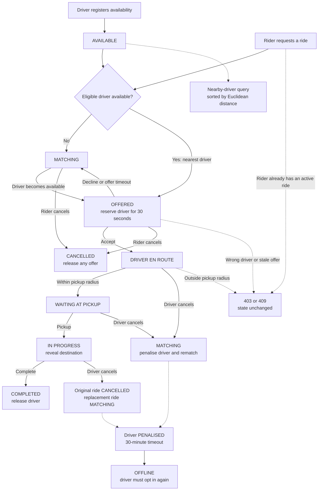

# Ride Matching Service

In-memory Spring Boot service that matches riders with drivers and enforces the ride lifecycle. All drivers and rides are lost when the application restarts.

## Local Development

From the repository root, you need Java 21, Docker Compose v2, and Windows PowerShell. IntelliJ IDEA is optional; the Maven wrapper provides the command-line path below.

1. Start the local identity provider:

   ```powershell
   docker compose up -d mock-idp
   ```

2. Start the API:

   ```powershell
   .\ride-matching-springboot\mvnw.cmd "-Dspring-boot.run.profiles=local" spring-boot:run
   ```

   Alternatively, open this project's `pom.xml` in IntelliJ as a Maven project, select a Java 21 SDK, and run `RideMatchingSpringbootApplication` with the `local` profile.

The API starts on `http://localhost:8080`. Its defaults use the local issuer and allow the passenger and driver applications at `http://localhost:4200` and `http://localhost:4201`.

Stop the API with `Ctrl+C`, then stop the local issuer when finished:

```powershell
docker compose stop mock-idp
```

### Local Identity Provider

Local authentication is provided by the workspace's `mock-idp` Docker service, which runs Navikt's [`mock-oauth2-server`](https://github.com/navikt/mock-oauth2-server). Its configuration is in [the workspace Compose file](../compose.yaml) and [the mock-IDP configuration](../infra/mock-idp/config.json).

The local issuer is `http://localhost:8090/ride`; its public signing keys are at `http://localhost:8090/ride/jwks`. It is test infrastructure, not a production identity provider. Production deployments must set `JWT_ISSUER_URI` and `JWT_JWK_SET_URI` for their real provider.

Use a unique subject beginning with `driver-`, `rider-`, or `admin-`, such as `driver-alex` or `rider-sam`. The mock provider puts that value in the JWT `sub` claim and adds the matching `DRIVER`, `RIDER`, or `ADMIN` value to its `roles` claim.

## Test The API

[`openapi.yaml`](openapi.yaml) is the API reference used by the Angular application. Use the passenger and driver applications for the preferred manual test path, or follow the [Bruno collection instructions](bruno/README.md) for a desktop API client.

The passenger and driver applications are the preferred manual test harness. Their setup is in the [Angular README](../ride-matching-angular/README.md).

## API

| Role | Method | Path |
|---|---|---|
| DRIVER | GET | `/drivers/me` |
| DRIVER | PUT | `/drivers/me/availability` |
| DRIVER | PUT | `/drivers/me/location` |
| DRIVER | GET | `/drivers/me/ride` |
| DRIVER | GET | `/drivers/me/state` |
| RIDER | POST | `/rides` |
| RIDER | GET | `/riders/me/ride` |
| RIDER | DELETE | `/riders/me/ride` |
| DRIVER | POST | `/rides/{rideId}/accept` |
| DRIVER | POST | `/rides/{rideId}/decline` |
| DRIVER | POST | `/rides/{rideId}/arrive` |
| DRIVER | POST | `/rides/{rideId}/pickup` |
| DRIVER | POST | `/rides/{rideId}/complete` |
| DRIVER | POST | `/rides/{rideId}/cancel` |
| ADMIN | GET | `/drivers/available?latitude=&longitude=&limit=` |

The JWT `sub` identifies the rider or driver. `roles` determines what that caller may do. The API checks both role and ride ownership, so a driver cannot act on another driver's ride.

## Authentication

The service is a JWT resource server: it validates tokens but does not sign users in or issue tokens. The browser applications use OAuth 2.0 authorization code flow with PKCE (Proof Key for Code Exchange). PKCE ties the sign-in code returned to the browser to the application that started sign-in, preventing another client from exchanging an intercepted code.

The API validates the JWT signature against the issuer's JWK endpoint, checks its issuer, reads `roles` as Spring `ROLE_*` authorities, and uses `sub` as the caller identity.

## Lifecycle

One rider can have one active ride, and one driver can have one offered or active ride. Creating a ride succeeds even when no driver is available. The service chooses the nearest eligible available driver; distance ties are resolved by driver ID.

| Ride status | Meaning | Driver action |
|---|---|---|
| `MATCHING` | Waiting for an eligible driver. | Set availability to trigger matching. |
| `OFFERED` | Offered to one driver for 30 seconds by default. | Accept or decline. |
| `DRIVER_EN_ROUTE` | Driver accepted and is travelling to pickup. | Update location, then arrive. |
| `WAITING_AT_PICKUP` | Driver is within the configured pickup radius. | Pick up the rider. |
| `IN_PROGRESS` | Ride has started. | Complete or cancel. |
| `COMPLETED` | Ride finished. | None. The driver becomes available. |
| `CANCELLED` | A rider cancelled before acceptance, or a driver cancelled after pickup. | None. A replacement ride may be matching after a driver cancellation. |

The driver cannot see the destination until `pickup` succeeds; riders always receive it. `arrive` requires the driver's most recently reported location to be inside the pickup radius.

Declining an offer or letting it time out returns the driver to `AVAILABLE`, excludes them from that ride, and offers it to the next eligible driver without penalty. Cancelling before pickup penalizes the driver and rematches the same ride. Cancelling after pickup marks the original ride `CANCELLED` and creates a replacement from the driver's last reported location to the original destination.

Offer expiry and penalty expiry are checked every second and before each lifecycle operation. After the default 30-minute penalty expires, a driver becomes `OFFLINE` and must explicitly become available again.

### Lifecycle Diagram



## Configuration

```properties
ride.gps.pickup-radius-metres=50
ride.offer-timeout=30s
ride.penalty-duration=30m
app.jwt.jwk-set-uri=${JWT_JWK_SET_URI}
app.jwt.issuer-uri=${JWT_ISSUER_URI}
```
